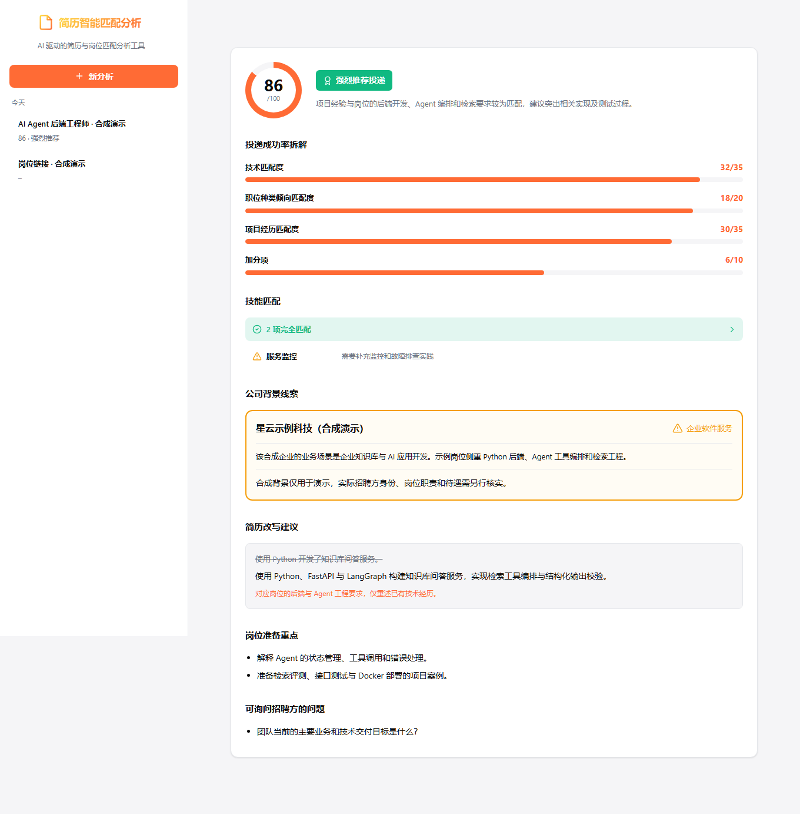
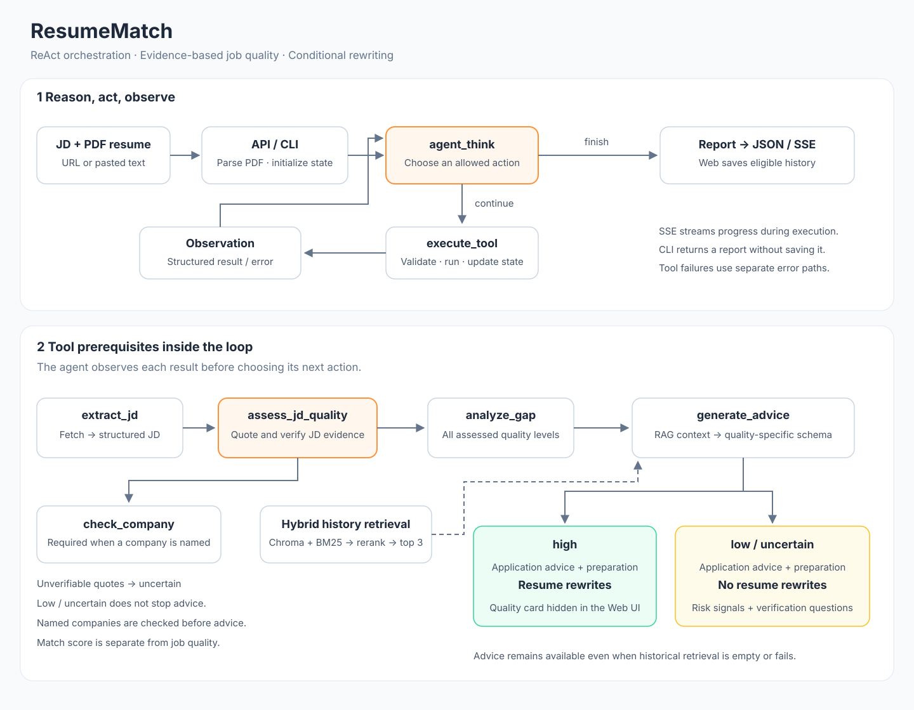
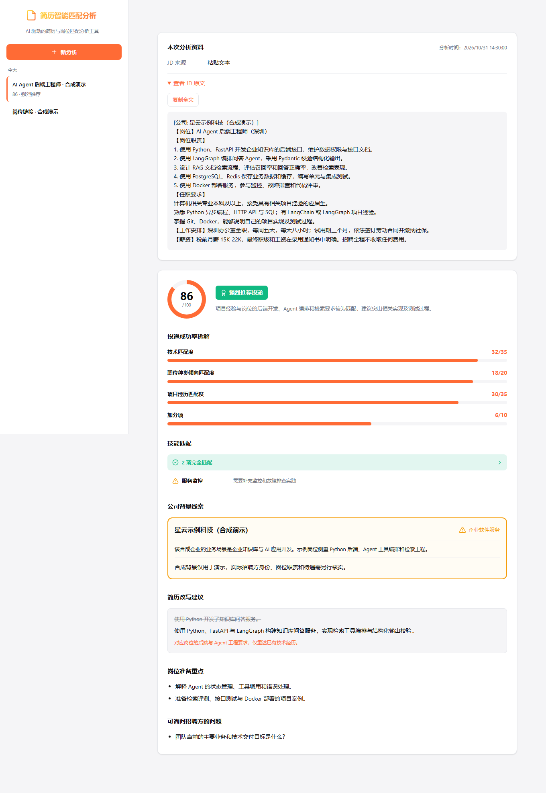
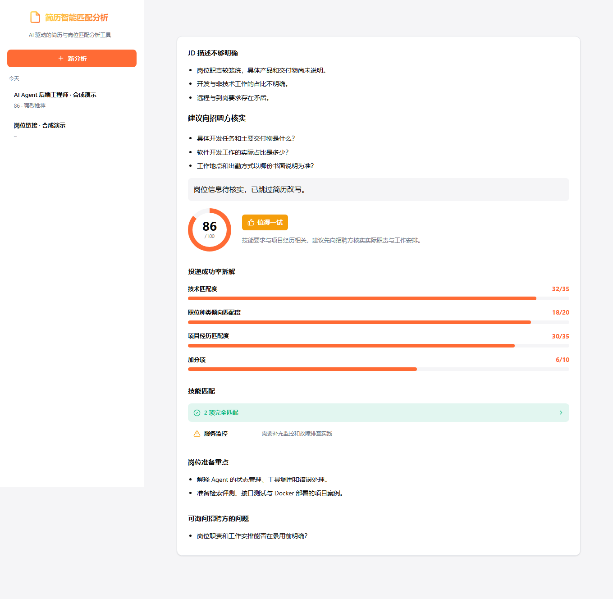
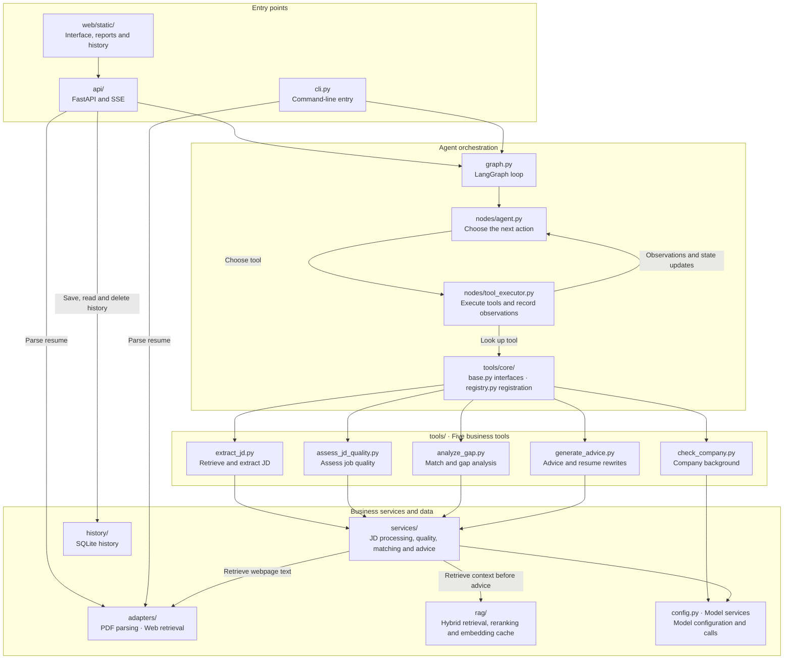

# ResumeMatch

[简体中文](README.md) | **English**

An AI agent for analyzing how well a resume matches a job description (JD).

Inspired by and built upon the MIT-licensed implementation of [JD-Scout](https://github.com/AlanYy-42/JD-Scout), this project extends the original workflow with agent orchestration, hybrid retrieval, caching, model fallback, streaming APIs, and offline evaluation.

## Demo



Upload a PDF resume and enter a job description or URL to receive a match analysis and application advice. The system assesses job quality first and only generates resume rewrites for sufficiently clear and reasonable descriptions. Screenshots use synthetic examples and show the Chinese-language interface.

## Agent Execution Flow



The diagram shows the reasoning and tool execution loop, job-quality assessment, conditional rewriting, retrieval, and history storage.

## Features

### Core Capabilities

- **JD retrieval**: Accept a URL or pasted text and retrieve the job description when needed.
- **Structured extraction**: Extract requirements, skills, responsibilities, and other relevant job details.
- **Job-quality assessment**: Evaluate clarity, reasonable requirements, and recruitment risk using quoted JD evidence; continue advice even when rewriting is skipped.
- **Skill matching**: Compare resume skills against JD requirements using `matched`, `partial`, and `missing` ratings.
- **Gap analysis**: Identify strengths and missing skills, with an overall match score from 0 to 100.
- **Resume suggestions**: Generate grounded rewrites only for jobs assessed as `high` quality.
- **Role preparation**: Suggest technical topics to prepare and questions to ask the recruiter.

### Technical Highlights

- **ReAct-style agent**: Reason over the current state and select tools dynamically.
- **Hybrid RAG**: Combine vector retrieval through Chroma with BM25 keyword retrieval.
- **Hybrid ranking**: Retrieve candidates independently, combine rankings with normalized reciprocal rank fusion (RRF), and rerank using job-related features.
- **Structured model fallback**: Retry structured business-service calls and switch to a fallback model when needed.
- **Streaming progress**: Deliver progress updates through Server-Sent Events (SSE).

## Technology Stack

### Backend

- **Agent frameworks**: LangGraph 0.2+, LangChain 0.3+
- **LLM**: DeepSeek V4 Flash (primary) and Qwen 3.8 Max (fallback for structured business-service calls)
- **Embeddings**: BGE-M3 through the SiliconFlow API
- **Vector database**: Chroma 0.5+
- **Text retrieval**: BM25 (`rank-bm25`)
- **Web framework**: FastAPI and uvicorn
- **PDF parsing**: pdfplumber
- **Web scraping**: httpx and Playwright

Model names and provider settings are defined in `src/resume_match/config.py`. Verify that the configured models are available to your API accounts before running the application.

### Frontend

- **Implementation**: HTML, CSS, and JavaScript
- **Progress updates**: Server-Sent Events (SSE)
- **Markdown rendering**: Marked.js

### Storage

- **History and source of truth**: SQLite (`~/.resume_match/history.db`)
- **Derived vector index**: Chroma (`~/.resume_match/chroma`)
- **Derived keyword index**: BM25, persisted with pickle (`~/.resume_match/bm25_index.pkl`)

## Quick Start

### Requirements

- Python 3.14 (`>=3.14,<3.15`)
- The uv package manager is recommended

### Installation

1. **Clone the repository**

   Replace `<repository-url>` with this repository's GitHub URL.

   ```bash
   git clone <repository-url> resume_match
   cd resume_match
   ```

2. **Install dependencies**

   ```bash
   # Using uv (recommended)
   uv sync --locked

   # Or using pip in your Python environment
   pip install -e .
   ```

3. **Install Chromium for Playwright**

   ```bash
   # After installing with uv
   uv run playwright install chromium

   # After installing with pip
   python -m playwright install chromium
   ```

4. **Configure environment variables**

   Copy `.env.example` to `.env`, then enter your API keys.

   ```bash
   cp .env.example .env
   ```

   In Windows PowerShell:

   ```powershell
   Copy-Item .env.example .env
   ```

### Environment Variables

API settings:

```bash
# DeepSeek API: primary model
DEEPSEEK_API_KEY=your_deepseek_api_key

# Alibaba Cloud DashScope API: fallback model
DASHSCOPE_API_KEY=your_dashscope_api_key

# SiliconFlow API: BGE-M3 embeddings
SILICONFLOW_API_KEY=your_siliconflow_api_key
SILICONFLOW_BASE_URL=https://api.siliconflow.cn/v1
```

Optional settings:

```bash
# Default for calls that do not explicitly select a model
DEFAULT_MODEL=deepseek

# In-process embedding cache; set either value to 0 to disable
EMBEDDING_CACHE_MAX_ENTRIES=256
EMBEDDING_CACHE_TTL_SECONDS=3600
```

`DEFAULT_MODEL` affects calls that do not explicitly select a model, such as company checks. Agent reasoning, JD extraction, quality assessment, gap analysis, and advice generation explicitly select DeepSeek; this setting does not switch the entire workflow to another model. Model identifiers and provider settings are defined in `src/resume_match/config.py`.

`CHROMA_DIR`, `SQLITE_PATH`, and `BM25_INDEX_PATH` can override storage locations. Use absolute paths when setting them: an explicit `~` in these values is not expanded. If unset, the application uses its default locations under the user's home directory.

### Start the Server

```bash
# Using uv
uv run uvicorn resume_match.api.server:app --reload --port 8000

# Or using uvicorn from your Python environment
uvicorn resume_match.api.server:app --reload --port 8000
```

Open [http://localhost:8000](http://localhost:8000).

## Usage

### Web Interface

1. Open [http://localhost:8000](http://localhost:8000) in your browser.
2. Upload a PDF resume.
3. Enter a JD URL or paste the job description.
4. Click **开始分析** (Start Analysis).
5. View progress updates and the final analysis.

Pasted JD text requires at least 200 characters. Leave the optional company field empty when entering a URL.

Historical reports include an **Analysis materials** card above the report. Expand and copy the original pasted JD, or copy and open the submitted job URL, and view the analysis timestamp. This card does not display the resume PDF. URL records retain the submitted link but do not retain the webpage text captured at analysis time; the page notes that the original site may have changed.



When a company name is identified, its background check must complete before advice generation. The company card shows the name, company type, and a short background paragraph without duplicate labels or an analysis prefix. Well-known companies also receive a specific business overview. If model calls fail for a recognized name, a name-list fallback explicitly states that detailed analysis is unavailable. Old records without company results show an unavailable state; rerun analysis to generate new content. Company context is based on model knowledge or name-list matches, not a live risk investigation.

| Quality | Analysis and application advice | Resume rewrites | Web display |
| --- | --- | --- | --- |
| `high` | Generated | Generated | Quality report hidden |
| `low` | Generated, including preparation and verification questions | Skipped | Risk evidence and advice shown |
| `uncertain` | Generated, including preparation and verification questions | Skipped | “JD 描述不够明确” (JD description is unclear); bulleted concerns and recruiter verification questions |



The `uncertain` card displays each concern as a separate bullet ending with “。”, without signal labels or JD quotations. If no concern description is available, it shows an empty-state message. The card retains its recruiter verification questions. Application advice, preparation topics, and recruiter questions also remain available below it.

### Command Line

```bash
uv run python -m resume_match.cli \
    --jd "$(cat examples/jd-high.txt)" \
    --resume tests/fixtures/sample_resume.pdf \
    --output result.json \
    --output-md result.md
```

The CLI can export JSON and Markdown reports. It does not automatically save analyses to the Web history database.

The command above uses Bash. For PowerShell:

```powershell
uv run python -m resume_match.cli --jd (Get-Content examples/jd-high.txt -Raw -Encoding utf8) --resume tests/fixtures/sample_resume.pdf --output result.json --output-md result.md
```

`examples/` contains complete synthetic JDs for all three quality paths. Running analysis calls the configured model APIs.

### Docker

After configuring `.env`, run:

```bash
docker compose up --build
```

The default port is 8000; history is persisted in the host's `~/.resume_match/` directory.

## Project Structure

### Module Diagram



Arrows describe module calls, not concurrent execution of all five tools. The agent selects permitted actions based on the current state; only `high` quality enables resume rewriting.

### Directory Layout

```text
resume_match/
├── README.md / README.en.md   # Chinese / English guides
├── assets/                    # Synthetic UI screenshots and SVG diagram
├── examples/                  # Complete synthetic JD inputs
├── .github/workflows/         # Offline CI
├── src/resume_match/
│   ├── api/                   # FastAPI and SSE endpoints
│   ├── nodes/                 # Agent decisions and tool execution
│   ├── tools/                 # Exactly five agent tools
│   │   ├── extract_jd.py
│   │   ├── assess_jd_quality.py
│   │   ├── check_company.py
│   │   ├── analyze_gap.py
│   │   ├── generate_advice.py
│   │   └── core/              # Infrastructure, not agent tools
│   │       ├── base.py
│   │       └── registry.py
│   ├── services/              # JD, quality, matching and advice services
│   ├── adapters/              # PDF parsing and webpage retrieval
│   ├── rag/                   # Hybrid retrieval, ranking and embedding cache
│   ├── history/               # SQLite histories
│   ├── evaluation/            # Retrieval evaluation code
│   ├── prompts/               # Prompt templates
│   ├── web/static/            # HTML, CSS and JavaScript
│   ├── cli.py                 # CLI
│   ├── config.py              # Model and application configuration
│   ├── state.py               # State and data schemas
│   └── graph.py               # LangGraph loop
├── scripts/                   # Startup, indexes, evaluation and release tools
├── evaluation/                # Public evaluation data and instructions
└── tests/                     # Offline regressions and synthetic PDF
```

Package declarations (`__init__.py`) are omitted. Tool interfaces and registration live in `tools/core/`. PDF and web I/O are imported directly from `adapters/`; obsolete forwarding modules have been removed from `tools/`.

## Architecture

### ReAct Agent Workflow

```text
JD text or URL + PDF resume
          ↓
FastAPI: parse resume and initialize state
          ↓
     agent_think ←─────────────────────────────┐
          ↓                                   │
     Select next action                       │
          ├─ Continue → execute_tool → Observation
          │                 │
          │                 ├─ extract_jd
          │                 ├─ assess_jd_quality
          │                 ├─ check_company
          │                 ├─ analyze_gap
          │                 └─ generate_advice
          │                      └─ Retrieve history → Prompt → LLM
          └─ Finish
               ↓
         Assemble report
               ↓
         Save history when eligible
               ↓
         Return JSON or SSE final_result
```

The graph has two nodes: `agent_think` and `execute_tool`. Retrieval runs inside `generate_advice`, rather than as a separately selected agent tool. Advice generation can continue without historical context if retrieval is empty or fails. The streaming endpoint sends progress events while the graph runs, then sends the final result after any eligible history save.

Extraction must be followed by quality assessment before gap analysis and advice generation. The agent chooses among allowed actions. An identified company must be checked before advice generation; the agent may choose whether to check the company before or after gap analysis. Company checks are skipped when no company name is available. High-quality jobs use a schema with resume rewrites. For `low / uncertain`, the model uses an advice-only schema and the public response contains `advice.bullet_rewrites=[]`.

Quality assessment requires evidence quoted from the original JD. Unsupported quotes downgrade the result to `uncertain`. Missing salary or an unfamiliar employer alone does not imply low quality. This is a text-based assessment, not external verification of employer identity or actual conditions; a match score is not a probability of being hired.

`rewrite_skipped_reason` explains why only rewriting was skipped. `stop_reason` describes early termination. Low or uncertain quality does not terminate the analysis.

### RAG Retrieval Workflow

```text
Structured JD
   ↓
Determine the candidate budget for each retrieval branch
   (35% of the larger index's record count, bounded to 15–80;
    all records for small datasets)
   ↓
Independent candidate retrieval
   ├─ Vector search through Chroma
   └─ BM25 keyword search
   ↓
Merge candidates by history ID and filter duplicate records
   ↓
Rerank using multiple factors
   ├─ Normalized RRF across both branches: 45%
   ├─ Skill match:                         35%
   ├─ Seniority match:                     10%
   ├─ Domain match:                         5%
   └─ Company match:                        5%
   ↓
Apply the relevance threshold
   ↓
Top-K results (up to 3 for advice generation)
   ↓
Advice prompt → LLM-generated suggestions
```

### Structured Model Retry and Fallback

The following policy applies to structured calls for JD extraction, quality assessment, gap analysis, advice generation, and the LLM branch of company checks. The `agent_think` reasoning call does not use this retry and fallback wrapper.

```text
Structured business-service request
   ↓
Primary model: DeepSeek V4 Flash
   └─ Up to 3 total attempts, with exponential backoff
            ↓ if all attempts fail
Fallback model: Qwen 3.8 Max
   └─ Up to 3 total attempts, with exponential backoff
            ↓ if all attempts fail
Raise an error for the caller to handle
```

These model names reflect the defaults in `src/resume_match/config.py`. Attempt counts include the initial call; the default waits between attempts are 0.5 and 1.0 seconds for each model.

## API Reference

### Analyze

**POST /api/analyze**

Send `multipart/form-data` with two required fields: `jd_text` (a job description or URL) and `resume_file` (a PDF resume).

```bash
curl -X POST http://localhost:8000/api/analyze \
    --form "jd_text=<examples/jd-high.txt" \
    --form "resume_file=@tests/fixtures/sample_resume.pdf"
```

The JSON response includes `jd`, `jd_quality`, `gap`, `advice`, `rewrite_skipped_reason`, `stop_reason`, `company_risk`, `errors`, `history_id`, and `similar_histories`.

### Stream Analysis

**POST /api/analyze/stream**

Use the same request fields as `/api/analyze`. The response is an SSE stream:

```bash
curl -N -X POST http://localhost:8000/api/analyze/stream \
    --form "jd_text=<examples/jd-high.txt" \
    --form "resume_file=@tests/fixtures/sample_resume.pdf"
```

Example progress events:

```text
event: node_start
data: {"node": "fetch_jd"}

event: node_end
data: {"node": "fetch_jd"}
```

Progress event names represent interface steps: `fetch_jd`, `extract`, `quality`, `analyze`, and `advise`. The actual LangGraph nodes are `agent_think` and `execute_tool`. The `final_result` event carries the complete analysis, and `error` carries error details. Interactive API documentation is available at [http://localhost:8000/docs](http://localhost:8000/docs).

### History

- **GET /api/history**: List saved analyses.
- **GET /api/history/{id}**: Get a saved analysis.
- **DELETE /api/history/{id}**: Delete a saved analysis.

## Development

### Add a Tool

1. Create a module in `src/resume_match/tools/`.
2. Inherit from the `Tool` base class.
3. Implement the `name`, `description`, and `input_schema` properties and the `execute` method.
4. Register the tool in `tools/core/registry.py`.
5. Add the tool to the allowed-action rules in `nodes/agent.py` and declare writable state fields in `nodes/tool_executor.py`. Add an API progress mapping if needed.

```python
from resume_match.tools.core.base import Tool, ToolInput, ToolOutput


class MyToolInput(ToolInput):
    text: str


class MyTool(Tool):
    @property
    def name(self) -> str:
        return "my_tool"

    @property
    def description(self) -> str:
        return "Trim whitespace from the supplied text."

    @property
    def input_schema(self) -> type[ToolInput]:
        return MyToolInput

    async def execute(self, input: MyToolInput, state: dict) -> ToolOutput:
        return ToolOutput(success=True, result={"text": input.text.strip()})
```

### Edit Prompts

Edit `src/resume_match/prompts/templates.py`:

- `EXTRACT_JD_PROMPT`: Structured JD extraction
- `ANALYZE_PROMPT`: Gap analysis
- `ADVISE_PROMPT`: Advice generation

The quality-assessment prompt is defined in `services/jd_quality.py`.

### Tune Retrieval

Adjust the weights in `src/resume_match/rag/fine_ranker.py`:

```python
final_score = (
    0.45 * retrieval_score +   # Normalized RRF across both branches
    0.35 * skill_score +       # Skill match
    0.05 * company_score +     # Company match
    0.10 * seniority_score +   # Seniority match
    0.05 * domain_score        # Domain match
)
```

## Troubleshooting

### A Job Page Cannot Be Retrieved

Some recruitment websites, including BOSS Zhipin, block automated access. Paste the job description directly when URL retrieval fails.

### An API Call Times Out

Check network connectivity, API credentials and quotas, provider availability, and the model settings in `src/resume_match/config.py`.

### Retrieval Results Are Not Relevant

- Add relevant analysis history. Saved records become available for retrieval; this does not train or update model weights.
- Adjust `FINE_THRESHOLD` in `fine_ranker.py`.

### A Model Returns No Structured Result

Structured business-service calls retry and can fall back to the secondary model. If they still fail, check API quotas and model availability. Agent reasoning calls do not use this fallback wrapper.

## Performance and Reliability

- **Persistent indexes**: Chroma and BM25 indexes are persisted to disk.
- **Embedding cache**: A bounded in-process LRU/TTL cache reuses embeddings for the same input and model settings. Concurrent requests for the same key share one call; failures are not cached.
- **Asynchronous I/O**: FastAPI supports asynchronous request handling.
- **Model fallback**: Structured business services can switch to a secondary model after primary-model failures. The usage ratio and cost require measurement.
- **Bounded retries**: The default is up to 3 attempts per model, with waits of 0.5 and 1.0 seconds. Higher attempt counts extend the waits to 2.0, 4.0 seconds, and so on. The retry count resets for the fallback model. Retries are not currently classified by error type.

## Acknowledgments

This project builds on open-source libraries and services from:

- LangGraph and LangChain for agent orchestration
- DeepSeek for LLM inference
- Alibaba Cloud for Qwen models
- SiliconFlow for the BGE-M3 embedding API
- Chroma for the embedded vector database

## License

This project is licensed under the MIT License. Copyright for the original JD-Scout code belongs to Ziming "Alan" Yi; copyright for additions and modifications in this repository belongs to Eirudy. See [LICENSE](LICENSE) for the full license and attribution.

## Upstream Attribution and Extensions

This project is inspired by and built upon the MIT-licensed [JD-Scout](https://github.com/AlanYy-42/JD-Scout) project by Ziming "Alan" Yi. The upstream project provided the baseline resume–JD analysis workflow. This repository extends it with:

- ReAct-style agent orchestration and isolated tool execution
- Evidence-based job-quality assessment and conditional resume rewriting
- Hybrid BGE-M3 and BM25 retrieval with RRF and feature-based reranking
- An embedding LRU/TTL cache with shared calls for concurrent requests using the same key
- Structured model retries and fallback
- SSE progress streaming
- BM25 lifecycle management and rebuilding
- Offline evaluation and regression tests

Do not commit real resumes, API keys, local databases, caches, or private evaluation data.

## Regression Tests

```bash
uv sync --locked --extra dev
uv run --extra dev python -m pytest -q
```

Tests block real HTTP requests by default. Networked end-to-end tests require an explicit `RUN_E2E=1` setting.

GitHub Actions runs offline regression tests, Ruff, and JavaScript syntax checks on Python 3.14 without API keys. Tests cover quality branches, company-check ordering, model failures, history and retrieval. Offline tests validate behavior rather than model accuracy.

If the default Windows pytest temporary directory is inaccessible, use a fresh path: `uv run --extra dev python -m pytest -q --basetemp temp/pytest-local -o cache_dir=temp/pytest-cache`. Pytest manages that directory; do not point it at personal files.

## Data Handling

The temporary uploaded PDF is deleted after text extraction. Resume text and the JD are sent to the configured model providers. Web history stores analysis results, which can include original resume snippets. SQLite, Chroma, and BM25 are stored locally by default. Authentication is not implemented; the default startup is intended for local single-user use. Screenshots, example JDs, and the test resume use synthetic data.

## Index Maintenance

Normal Web history saves and deletions update Chroma and BM25 independently. On first initialization of the storage service, BM25 is rebuilt from SQLite to refresh tokenization and metadata and remove deleted IDs. These operations are not a cross-store transaction, and multiple processes cannot safely write to the same BM25 file concurrently.

The embedding client sets `check_embedding_ctx_length=False` so that it sends text to SiliconFlow instead of OpenAI token IDs. Existing Chroma vectors are not regenerated automatically. To rebuild them, stop the application, back up the history data, and run:

```bash
uv run python scripts/rebuild_vector_index.py
```

This operation calls the live embedding API and may incur charges.

See [evaluation/README.md](evaluation/README.md) for RAG evaluation scripts, synthetic smoke-test data, import and export for manual blind labeling, and instructions for evaluation with real BGE embeddings. Reports based on synthetic data or fake embeddings validate the pipeline only; they do not establish production retrieval quality. Meaningful performance claims require a frozen test set with manually reviewed labels.

The embedding cache defaults to 256 entries with a one-hour TTL. Set its capacity or TTL to 0 to disable it.
