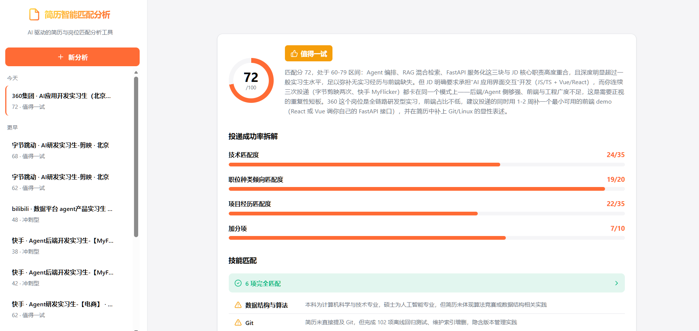
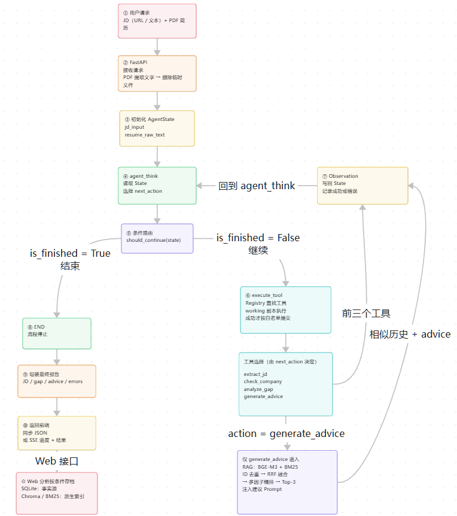

# ResumeMatch

**简体中文** | [English](README.en.md)

AI Agent 驱动的简历-JD 匹配分析系统。
本项目受到 [JD-Scout](https://github.com/AlanYy-42/JD-Scout) 的启发，在其 MIT 许可的开源实现基础上，进一步扩展了 Agent 编排、混合检索、缓存、模型降级、流式接口和离线评测等能力。

## 界面展示



上传 PDF 简历并输入岗位描述或链接，获取匹配分析与简历优化建议。

## Agent 核心执行流程



Agent 通过推理与工具执行循环完成分析；建议生成阶段检索历史记录，并将相关上下文交给模型生成建议。

## 功能特性

### 核心功能

- **智能 JD 抓取** - 支持 URL 输入或直接粘贴文本，自动识别并抓取职位描述
- **结构化分析** - 自动提取岗位要求、技能清单、工作职责等关键信息
- **技能匹配评估** - 逐项对比简历与 JD 要求，给出 matched/partial/missing 评级
- **差距分析** - 识别技能缺口和优势项，输出综合匹配评分（0–100 分）
- **简历优化建议** - 基于 JD 要求生成针对性的简历改写建议
- **岗位准备建议** - 提供技术准备重点和可询问招聘方的问题

### 技术亮点

- **ReAct Agent 架构** - 自主推理和动态工具调用
- **混合 RAG 检索** - 向量检索（Chroma）+ BM25 关键词匹配
- **混合排序** - 双路独立召回 + 归一化 RRF 排名融合 + 业务特征精排
- **多模型降级** - 结构化业务调用支持有限重试和备用模型降级
- **实时流式输出** - Server-Sent Events 推送进度

## 技术栈

### 后端

- **Agent 框架**: LangGraph 0.2+, LangChain 0.3+
- **LLM**: DeepSeek V4 Flash（主模型）+ Qwen 3.8 Max（结构化业务调用降级），模型标识见 `src/resume_match/config.py`
- **Embedding**: BGE-M3 (SiliconFlow API)
- **向量数据库**: Chroma 0.5+
- **文本检索**: BM25 (rank-bm25)
- **Web 框架**: FastAPI + uvicorn
- **PDF 解析**: pdfplumber
- **网页抓取**: httpx + Playwright

### 前端

- **技术栈**: 原生 HTML/CSS/JavaScript
- **实时通信**: Server-Sent Events (SSE)
- **Markdown 渲染**: Marked.js

### 数据存储

- **历史记录**: SQLite（默认 `~/.resume_match/history.db`），作为历史数据的事实源
- **向量索引**: Chroma（默认 `~/.resume_match/chroma`）
- **BM25 索引**: pickle 持久化（默认 `~/.resume_match/bm25_index.pkl`）

## 快速开始

### 环境要求

- Python 3.14（`>=3.14,<3.15`）
- 推荐使用 uv 包管理器

### 安装步骤

1. **克隆项目**

   将 `<repository-url>` 替换为本仓库的 GitHub 地址。

   ```bash
   git clone <repository-url> resume_match
   cd resume_match
   ```

2. **安装依赖**

   ```bash
   # 使用 uv (推荐)
   uv sync

   # 或使用 pip
   pip install -e .
   ```

3. **安装浏览器驱动**

   ```bash
   uv run playwright install chromium
   ```

   使用 pip 安装依赖时，在对应 Python 环境中运行 `python -m playwright install chromium`。

4. **配置环境变量**

   ```bash
   cp .env.example .env
   # 编辑 .env 文件，填入以下 API keys
   ```

   Windows PowerShell 可使用：

   ```powershell
   Copy-Item .env.example .env
   ```

### 环境变量配置

按默认主模型、备用模型和 Embedding 服务配置以下 API key：

```bash
# DeepSeek API (主模型)
DEEPSEEK_API_KEY=your_deepseek_api_key

# 阿里云 DashScope API (备用模型)
DASHSCOPE_API_KEY=your_dashscope_api_key

# SiliconFlow API (BGE-M3 嵌入模型)
SILICONFLOW_API_KEY=your_siliconflow_api_key
SILICONFLOW_BASE_URL=https://api.siliconflow.cn/v1
```

可选配置：

```bash
# 未显式指定模型的调用使用此默认值，例如公司检查
DEFAULT_MODEL=deepseek

# 进程内 Embedding 缓存；任一项为 0 时关闭
EMBEDDING_CACHE_MAX_ENTRIES=256
EMBEDDING_CACHE_TTL_SECONDS=3600
```

Agent 推理、JD 提取、差距分析和建议生成目前显式使用 DeepSeek，`DEFAULT_MODEL` 不会切换这些调用。模型标识和服务地址在 `src/resume_match/config.py` 中配置。

存储位置可通过 `SQLITE_PATH`、`CHROMA_DIR` 和 `BM25_INDEX_PATH` 设置。自定义时请使用绝对路径；不设置时使用上面的用户目录默认值。环境变量中的 `~` 不会自动展开。

### 启动服务

```bash
# 使用 uv
uv run uvicorn resume_match.api.server:app --reload --port 8000

# 或直接使用已安装的 uvicorn
uvicorn resume_match.api.server:app --reload --port 8000

# 服务默认运行在 http://localhost:8000
```

## 使用指南

### Web 界面

1. 打开浏览器访问 http://localhost:8000
2. 上传简历 PDF
3. 输入 JD URL 或粘贴 JD 文本
4. 点击"开始分析"
5. 实时查看分析进度和结果

### CLI 模式

```bash
uv run python -m resume_match.cli \
    --jd "岗位职责：Python 服务开发；熟悉 FastAPI、Docker 和 RAG" \
    --resume /path/to/resume.pdf \
    --output result.json \
    --output-md result.md
```

CLI 支持 JSON 和 Markdown 报告输出，不会自动存档到 Web 历史记录。

## 项目结构

```text
resume_match/
├── README.md             # 中文说明
├── README.en.md          # 英文说明
├── assets/               # 界面截图和流程图
├── evaluation/           # 离线评测说明与合成数据
├── scripts/              # 评测与索引维护脚本
├── src/resume_match/
│   ├── api/              # FastAPI 服务端
│   ├── nodes/            # LangGraph 图节点
│   │   ├── agent.py      # Agent 推理节点
│   │   └── tool_executor.py # 工具执行节点
│   ├── services/         # 工具调用的业务服务
│   │   ├── jd_fetcher.py     # JD 抓取
│   │   ├── jd_extractor.py  # 结构化提取
│   │   ├── gap_analyzer.py  # 差距分析
│   │   ├── adviser.py       # 建议生成
│   │   └── structured_llm.py # 结构化 LLM 重试/降级
│   ├── rag/              # RAG 检索系统
│   │   ├── embedder.py   # 嵌入模型
│   │   ├── vector_store.py   # 向量库
│   │   ├── bm25_store.py     # BM25 索引
│   │   ├── coarse_ranker.py  # 粗排
│   │   ├── fine_ranker.py    # 精排
│   │   └── retriever.py      # 检索器
│   ├── tools/            # Agent 可调用工具、工具基类与注册中心
│   │   ├── extract_jd.py
│   │   ├── check_company.py
│   │   ├── analyze_gap.py
│   │   ├── generate_advice.py
│   │   ├── base.py
│   │   └── registry.py
│   ├── adapters/         # 外部输入与第三方 I/O 适配
│   │   ├── pdf_parser.py
│   │   └── web_scraper.py
│   ├── history/          # 历史记录管理
│   ├── prompts/          # Prompt 模板
│   ├── config.py         # 配置管理
│   ├── state.py          # 状态定义
│   └── graph.py          # LangGraph 主图
├── src/resume_match/web/ # 前端静态文件
└── tests/                # 测试文件
```

说明：`tools/pdf_parser.py` 和 `tools/web_scraper.py` 仅保留向后兼容转发，实际实现位于 `adapters/`。

## 核心架构

### ReAct Agent 流程

```text
JD 文本或 URL + PDF 简历
   ↓
解析输入 → 初始化 AgentState
   ↓
agent_think
   ├─ 继续 → execute_tool → Observation → agent_think
   └─ 结束 → 组装报告 → Web 按条件存档 → 返回最终结果
```

`execute_tool` 调用已注册的 `extract_jd`、`check_company`、`analyze_gap` 或 `generate_advice`。RAG 位于 `generate_advice` 内部：检索相似历史记录，将最多 3 条结果注入 Prompt，再调用模型生成建议。检索无结果或失败时，仍可在不附加历史上下文的情况下生成建议。

Web 流式接口在执行过程中推送 SSE 进度，最终结果在按条件存档后发送。CLI 直接返回报告。

### RAG 检索流程

```text
查询 JD
   ↓
确定每路候选预算（索引数量较大值的 35%，15–80 条；小库取全部）
   ↓
双路召回
   ├─ 向量检索（Chroma）
   └─ BM25 检索
   ↓
按历史 ID 合并候选并过滤重复记录
   ↓
精排（多因子打分）
   ├─ 双路归一化 RRF 45%
   ├─ 技能匹配   35%
   ├─ 资历匹配   10%
   ├─ 领域匹配   5%
   └─ 公司匹配   5%
   ↓
阈值过滤 → Top-K 结果（建议生成阶段最多 3 条）
```

### 多模型降级策略

以下策略适用于 JD 提取、差距分析、建议生成及公司检查的结构化 LLM 分支。Agent 决策节点本身不使用这一重试和降级封装。

```text
结构化业务调用
   ↓
主模型（默认 DeepSeek V4 Flash）最多尝试 3 次
   ↓ 全部失败
备用模型 Qwen 3.8 Max 最多尝试 3 次
   ↓ 全部失败
返回错误
```

每个模型的尝试次数包含首次调用；默认两次重试等待分别为 0.5 秒和 1.0 秒。

## API 文档

### 分析接口

**POST /api/analyze**

使用 `multipart/form-data` 提交两个必填字段：`jd_text`（JD 文本或 URL）和 `resume_file`（简历 PDF）。

```bash
curl -X POST http://localhost:8000/api/analyze \
    --form-string "jd_text=岗位职责：Python 服务开发；熟悉 FastAPI 和 Docker" \
    --form "resume_file=@/path/to/resume.pdf"
```

分析完成后返回 JSON，包含 `jd`、`gap`、`advice`、`company_risk`、`errors`、`history_id` 和 `similar_histories`。

### 流式分析接口

**POST /api/analyze/stream**

请求字段与 `/api/analyze` 相同，响应为 SSE 事件流：

```bash
curl -N -X POST http://localhost:8000/api/analyze/stream \
    --form-string "jd_text=岗位职责：Python 服务开发；熟悉 FastAPI 和 Docker" \
    --form "resume_file=@/path/to/resume.pdf"
```

进度事件示例：

```text
event: node_start
data: {"node": "fetch_jd"}

event: node_end
data: {"node": "fetch_jd"}
```

`final_result` 事件携带完整分析结果；`error` 事件携带错误信息。交互式接口文档见 http://localhost:8000/docs。

进度中的 `node` 是前端步骤标识，可为 `fetch_jd`、`extract`、`analyze`、`advise`；实际 LangGraph 节点是 `agent_think` 和 `execute_tool`。

### 历史记录接口

**GET /api/history** - 获取历史记录列表

**GET /api/history/{id}** - 获取单条历史记录

**DELETE /api/history/{id}** - 删除历史记录

## 开发指南

### 添加新工具

1. 在 `src/resume_match/tools/` 创建工具文件
2. 继承 `Tool` 基类
3. 实现 `name`、`description`、`input_schema` 属性和 `execute` 方法
4. 在 `tools/registry.py` 注册工具

示例：

```python
from resume_match.tools.base import Tool, ToolInput, ToolOutput


class MyToolInput(ToolInput):
    text: str


class MyTool(Tool):
    @property
    def name(self) -> str:
        return "my_tool"

    @property
    def description(self) -> str:
        return "去除输入文本首尾的空白字符。"

    @property
    def input_schema(self) -> type[ToolInput]:
        return MyToolInput

    async def execute(self, input: MyToolInput, state: dict) -> ToolOutput:
        return ToolOutput(success=True, result={"text": input.text.strip()})
```

### 修改 Prompt

编辑 `src/resume_match/prompts/templates.py`：

- `EXTRACT_JD_PROMPT` - JD 结构化提取
- `ANALYZE_PROMPT` - 差距分析
- `ADVISE_PROMPT` - 建议生成

### 调整检索策略

修改 `src/resume_match/rag/fine_ranker.py` 中的权重：

```python
final_score = (
    0.45 * retrieval_score +   # 双路归一化 RRF
    0.35 * skill_score +       # 技能匹配
    0.05 * company_score +     # 公司匹配
    0.10 * seniority_score +   # 资历匹配
    0.05 * domain_score        # 领域匹配
)
```

## 常见问题

### 网页抓取失败

部分招聘网站有强反爬保护（如 BOSS直聘），建议直接粘贴 JD 文本。

### API 调用超时

检查网络连接、API key 配额、`config.py` 中的模型配置以及模型服务的运行状态。

### 向量检索结果不准确

- 增加历史记录数量（历史会持续入库供检索，模型权重不会自动训练）
- 调整精排阈值（`fine_ranker.py` 中的 `FINE_THRESHOLD`）

### 模型返回空结果

结构化业务调用会对空结果和异常进行有限重试，并在主模型尝试耗尽后调用备用模型；如仍失败，请检查 API key 配额和模型配置。

## 性能优化

- **Embedding 缓存**: 进程内 LRU/TTL 缓存，相同输入与模型配置可复用向量，同键并发共享调用
- **索引持久化**: Chroma 和 BM25 索引写入磁盘，作为 SQLite 历史记录的派生索引
- **并发处理**: FastAPI 异步 I/O
- **模型降级**: 结构化业务调用的主模型尝试耗尽后可调用备用模型；调用比例和成本需实际测量
- **有限重试**: 默认最多每模型 3 次尝试，指数等待 0.5/1.0 秒；增加尝试次数时后续为 2.0/4.0 秒，切换备用模型后重新计数；尚未实现按错误类型分类重试

## 致谢

感谢开源社区提供的灵感和参考实现。

- LangGraph & LangChain 团队提供的 Agent 框架
- DeepSeek 提供高性价比的 LLM 推理
- 阿里云提供通义千问模型
- SiliconFlow 提供 BGE-M3 嵌入模型 API
- Chroma 的嵌入式向量库

## 许可证

本项目使用 MIT License。上游 JD-Scout 的原始代码版权归
Ziming "Alan" Yi 所有；本仓库新增和修改部分版权归 Eirudy 所有。完整许可文本和
归属信息见 [LICENSE](LICENSE)。

## 上游来源与扩展

本项目受到 Ziming "Alan" Yi 的 [JD-Scout](https://github.com/AlanYy-42/JD-Scout) 启发，并基于其 MIT 许可的开源实现进行扩展。上游提供了基础的简历与 JD 分析流程，本仓库进一步扩展了以下能力：

- ReAct 风格的 Agent 编排和隔离工具执行
- BGE-M3 与 BM25 混合检索、RRF 融合和业务特征精排
- Embedding LRU/TTL 缓存与同键请求共享
- 结构化模型调用的重试与降级处理
- SSE 进度推送
- BM25 索引生命周期管理与重建
- 离线评测和回归测试

请勿提交真实简历、API key、本地数据库、缓存或私有评测数据。

## 回归测试与索引迁移

```powershell
uv sync --extra dev
uv run --extra dev python -m pytest -q
```

默认测试禁止真实 HTTP，联网 E2E 需显式设置 `RUN_E2E=1`。
正常 Web 存档/删除会独立更新 Chroma 和 BM25；存储首次初始化会从 SQLite 完整重建 BM25，清除旧的分词/元数据和已删除 ID。
这不是跨存储事务，也不支持多个进程同时写同一个 BM25 文件。

Embedding 客户端已设置 `check_embedding_ctx_length=False`，确保向 SiliconFlow 发送文本而非 OpenAI token ID；原有 Chroma 向量不会自动更新。
如需重新生成，先停止应用、备份历史数据，再运行 `uv run python scripts/rebuild_vector_index.py`。该操作会调用实际 Embedding API 并产生费用。

RAG 评测脚本、合成 smoke 数据、人工盲标导入导出和真实 BGE 评测步骤见 [evaluation/README.md](evaluation/README.md)。合成/假向量报告只验证流程，不能作为线上效果；真实指标必须基于人工复核的冻结测试集。

Embedding 支持有界进程内 LRU/TTL 缓存（默认 256 条、1 小时），复用相同输入和模型配置的向量，同键并发共享调用、失败不缓存。容量或 TTL 设为 0 可关闭。
